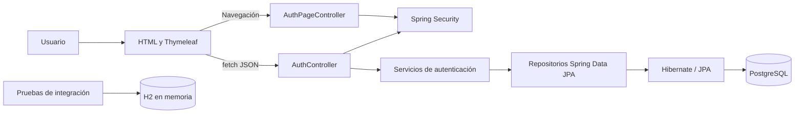

# Siweb Eclipse

Aplicación web para la gestión de un hotel. El proyecto usa Spring Boot y está organizado como un monolito por capas: interfaz web, controladores, servicios, repositorios y entidades JPA.

## Estado actual

### Implementado

- Portada de Hotel Eclipse y página 404 personalizadas.
- Login de empleados con usuario y contraseña, usando el servicio de autenticación integrado desde `feature/login`.
- Registro de clientes con datos personales, correo y contraseña; al registrarse, el cliente queda autenticado.
- Login de clientes por correo y contraseña.
- Contraseñas de clientes y empleados almacenadas con BCrypt; nunca se guarda la contraseña en texto plano.
- Sesiones HTTP para los accesos de cliente y empleado.
- Validación de datos, normalización de correos, rechazo de correo/documento duplicados y respuestas JSON de error.
- Actualización del esquema mediante Hibernate con `spring.jpa.hibernate.ddl-auto=update`.
- Pruebas unitarias, MVC y de integración con H2 en memoria. La prueba de integración registra un cliente, comprueba el hash persistido y vuelve a autenticarlo.

### Pendiente o limitado

- Recuperación de contraseña, verificación de correo y confirmación de identidad.
- Controles adicionales para producción, como límites de intentos, política de contraseñas y configuración de cookies seguras bajo HTTPS.
- Redirección tras el login a un panel según el rol y controles visibles para cerrar sesión.
- Conectar los módulos de reservas, recepción, room service, operaciones y reportes. Hay plantillas y clases preparadas, pero actualmente no se encontraron rutas MVC registradas para esos flujos.
- Validar la actualización del esquema sobre una copia de la base PostgreSQL usada por el equipo. Las pruebas automáticas usan H2 y no modifican esa base.
- Cambiar o eliminar las credenciales de empleados de prueba antes de desplegar.

## Tecnologías

- Java 21+
- Spring Boot 4
- Spring MVC y Thymeleaf
- Spring Security
- Spring Data JPA / Hibernate
- PostgreSQL para ejecución local y despliegue
- H2 solo para pruebas
- HTML, CSS y JavaScript sin framework para las vistas de autenticación
- Maven Wrapper

## Arquitectura



### Responsabilidades por capa

- `controller`: recibe peticiones REST y solicitudes de páginas Thymeleaf.
- `service`: valida y ejecuta reglas de negocio, como registro, normalización de correo y autenticación BCrypt.
- `dao`: repositorios Spring Data JPA para consultar y persistir entidades.
- `entity`: modelo relacional persistido, incluyendo `Cliente` y `Empleado`.
- `dto`: contratos de entrada/salida de la API; evita exponer directamente las entidades.
- `config`: seguridad, codificador BCrypt, inicialización de empleados de desarrollo y configuración de Spring.
- `resources/static`: portada, estilos y JavaScript que consume la API.
- `resources/templates`: páginas Thymeleaf de login, registro, error y vistas de los módulos.

## Rutas implementadas

| Método | Ruta | Uso |
| --- | --- | --- |
| `GET` | `/` | Portada pública. |
| `GET` | `/login?tipo=empleado` | Formulario de login de empleado. |
| `GET` | `/login?tipo=cliente` | Formulario de login de cliente. |
| `GET` | `/registro` | Formulario de registro de cliente. |
| `POST` | `/api/auth/login` | Login de empleado; recibe `username` y `password`. |
| `GET` | `/api/auth/me` | Datos del empleado autenticado. |
| `POST` | `/api/auth/client/register` | Registra y autentica un cliente. |
| `POST` | `/api/auth/client/login` | Login de cliente; recibe `correoElectronico` y `password`. |
| `GET` | `/api/auth/client/me` | Datos del cliente autenticado. |
| `POST` | `/api/auth/logout` | Cierra la sesión API actual. |

El registro de cliente recibe `tipoDocumento`, `numDocumento`, `paisEmisionDoc`, `correoElectronico`, `nombre`, `apellido`, `telefono`, `edad` y `password`. La confirmación de contraseña se comprueba en el navegador y no se envía al servidor.

Las rutas API usan sesión HTTP y responden JSON. La API tiene CSRF desactivado; la cadena web mantiene CSRF activo. Las contraseñas se codifican con BCrypt. Los clientes tienen autoridad `ROLE_CLIENTE`; los empleados reciben sus roles y permisos desde la base.

## Requisitos

- JDK 21 o superior.
- PostgreSQL instalado y en ejecución para el perfil normal.
- Base de datos `siweb_eclipse` creada para el perfil normal.
- Git.

Para una demostración sin configurar PostgreSQL, el perfil `demo` usa H2 en memoria.

No hace falta instalar Maven globalmente: el repositorio incluye `mvnw` y `mvnw.cmd`.

## Configuración y ejecución

### Demostración sin PostgreSQL

En Windows, desde la raíz del proyecto:

```powershell
$env:SPRING_PROFILES_ACTIVE = "demo"
.\mvnw.cmd spring-boot:run
```

En Linux/macOS:

```bash
SPRING_PROFILES_ACTIVE=demo ./mvnw spring-boot:run
```

Abre [http://localhost:8080](http://localhost:8080). Puedes crear clientes desde `/registro` y entrar como empleado con una cuenta de desarrollo. La base H2 de demostración vive solo mientras la aplicación está abierta: al detenerla, sus registros se eliminan. Esto permite probar el flujo sin PostgreSQL; no uses este perfil para producción.

### Ejecución con PostgreSQL

Configura la contraseña de PostgreSQL mediante la variable `DB_PASSWORD`. En PowerShell, el siguiente comando la solicita sin mostrarla ni enviarla al chat:

```powershell
$secure = Read-Host "Contraseña de PostgreSQL" -AsSecureString
$env:DB_PASSWORD = [System.Net.NetworkCredential]::new("", $secure).Password
```

Después, desde la raíz del proyecto:

```powershell
.\mvnw.cmd spring-boot:run
```

En Linux/macOS:

```bash
export DB_PASSWORD="contraseña-local"
./mvnw spring-boot:run
```

Abre [http://localhost:8080](http://localhost:8080). No abras `src/main/resources/static/index.html` directamente como archivo: sus rutas `/login` y `/registro` requieren que Spring Boot esté sirviendo la aplicación.

La configuración actual usa `jdbc:postgresql://localhost:5432/siweb_eclipse`, usuario `postgres` y un valor de respaldo `123456` si `DB_PASSWORD` no está definido. Se recomienda configurar siempre la variable de entorno y no depender del valor de respaldo.

### Cuentas de empleado de desarrollo

`DataInitializer` crea estas cuentas si no existen:

| Usuario | Contraseña | Rol |
| --- | --- | --- |
| `admin` | `Admin@123` | `ADMIN` |
| `recepcion1` | `Recep@123` | `RECEPCION` |
| `roomservice1` | `Room@123` | `ROOMSERVICE` |

Son credenciales de desarrollo; cámbialas antes de cualquier despliegue. Las cuentas de cliente se crean desde `/registro`.

## Pruebas

Ejecutar toda la suite:

```powershell
.\mvnw.cmd test
```

En Linux/macOS:

```bash
./mvnw test
```

Las pruebas de contexto e integración configuran H2 en memoria. No requieren `DB_PASSWORD` ni escriben en PostgreSQL. La última ejecución completa registrada pasó 48 pruebas.

## Estructura del proyecto

```text
src/
  main/
    java/pe/com/eclipsesuites/
      config/
      controller/
      dao/
      dto/
      entity/
      service/
      util/
    resources/
      static/css/
      static/js/
      templates/
  test/java/pe/com/eclipsesuites/
```

## Git

Crear una rama:

```bash
git checkout -b nombre-de-la-rama
```

Guardar y subir cambios:

```bash
git add .
git commit -m "Describe el cambio"
git push --set-upstream origin nombre-de-la-rama
```

## Licencia

Proyecto académico / interno del equipo. Ajustar según corresponda.
