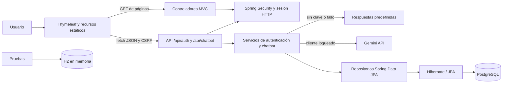

# Siweb Eclipse

Aplicación web para la gestión de un hotel. El proyecto usa Spring Boot y está organizado como un monolito por capas: interfaz web, controladores, servicios, repositorios y entidades JPA.

## Estado actual

### Implementado

- Portada de Hotel Eclipse y página 404 personalizadas.
- Login de empleados con usuario y contraseña, con roles y permisos cargados desde la base de datos.
- Registro de clientes en dos pasos: datos personales y credenciales; al terminar se inicia la sesión sin depender de códigos por correo o SMS.
- Aceptación de privacidad registrada con fecha al crear la cuenta.
- Login de clientes por correo y contraseña.
- Contraseñas de clientes y empleados almacenadas con BCrypt; nunca se guarda la contraseña en texto plano.
- Sesiones HTTP para los accesos de cliente y empleado.
- Catálogo de siete suites y flujo de reserva por habitación física, con disponibilidad por intervalo, duración de 4, 6 o 12 horas y vista previa.
- Catálogo público `/catalogo` con disponibilidad operativa y por fecha/hora, filtros por texto, disponibilidad, duración y orden, ficha de detalle por suite, amenidades y API JSON reutilizable.
- Retención de cinco minutos mientras se paga; en el perfil `demo` los métodos de pago se simulan y no se captura ni procesa dinero.
- Código QR tras el pago para check-in de recepción; ampliaciones de estadía disponibles en el flujo demo después del check-in.
- Catálogo de demostración con precios de muestra e inventario aislados en el perfil `demo`.
- Bloqueo temporal de 3 minutos a partir del quinto fallo para la combinación de IP y usuario/correo.
- Validación de datos, normalización de correos, rechazo de correo/documento duplicados y respuestas JSON de error.
- Interfaz de autenticación adaptable a móvil, con fondo del hotel, wizard de registro, transiciones y animaciones breves; respeta `prefers-reduced-motion`.
- Actualización del esquema mediante Hibernate con `spring.jpa.hibernate.ddl-auto=update`.
- Pruebas unitarias, MVC y de integración con H2 en memoria para registro, autenticación, validaciones y sesión.
- Asistente **Eclipse Suites** en `/asistente`: catálogo de suites a la izquierda y chat a la derecha, con tarjetas construidas desde `Habitacion`, `TipoHabitacion` y `TarifaHabitacion`.
- Widget flotante de chat disponible en la portada y en `/inicio` para cualquier visitante.
- Respuestas públicas sin cuenta para saludo, tarifas, disponibilidad, servicios y política de estadía; el resto de preguntas invita a crear una cuenta.
- Preguntas libres de clientes logueados contra la API de Gemini (`GEMINI_API_KEY`), con respaldo automático a respuestas predefinidas si el servicio falla.
- Límites de uso: 10 mensajes/minuto por IP y 12 por conversación anónima; 30/minuto para clientes.
- Derivación a recepción registrada en la conversación con cola de espera estimada de 2 minutos.

### Pendiente o limitado

- Recuperación de contraseña y controles independientes contra abuso distribuido (los límites actuales viven en memoria).
- Paneles distintos por rol y controles visibles para cerrar sesión. El login redirige a `/inicio`, pero esa página no diferencia todavía las capacidades por rol.
- Activar checkout, rack, room service, operaciones y reportes. Esos módulos todavía no tienen implementación activa ni rutas MVC registradas.
- Cargar en PostgreSQL el catálogo, inventario e importes reales del hotel. El perfil `demo` solo usa precios de muestra.
- Validar la actualización del esquema sobre una copia de la base PostgreSQL usada por el equipo. Las pruebas automáticas usan H2 y no modifican esa base.
- Cambiar o eliminar las credenciales de empleados de prueba antes de desplegar.
- Conectar la cola de derivación del asistente a una pantalla de recepción. Hoy solo se registra `derivo_a_reserva` y el estado de cola en memoria.
- Mover los límites del asistente y la cola de derivación a almacenamiento compartido antes de desplegar más de una instancia.

## Tecnologías

- Java 21+
- Spring Boot 4
- Spring MVC y Thymeleaf
- Spring Security
- Spring Data JPA / Hibernate
- PostgreSQL para el perfil normal y despliegue
- H2 en memoria para el perfil `demo` y para pruebas
- HTML, CSS y JavaScript sin framework para las vistas de autenticación
- Maven Wrapper

## Arquitectura

La aplicación es un monolito Spring Boot/MVC. La descripción de módulos, rutas, seguridad, persistencia y estado de implementación está en [ARCHITECTURE.md](./ARCHITECTURE.md).



### Responsabilidades por capa

- `controller`: recibe solicitudes REST y de páginas; las rutas activas son portada/inicio, autenticación y asistente.
- `service`: valida y ejecuta reglas de registro, política de correo, autenticación y bloqueo de intentos; `service/impl` contiene la orquestación del chatbot y `service/gemini` el cliente HTTP de Gemini.
- `dao`: repositorios Spring Data JPA para consultar y persistir entidades.
- `entity`: modelo relacional persistido, incluyendo `Cliente`, `Empleado`, `Habitacion`, `ConversacionChatbot` y `MensajeChatbot`.
- `dto`: contratos de entrada/salida de la API; evita exponer directamente las entidades.
- `config`: seguridad, codificador BCrypt, configuración del chatbot, semillas de suites de desarrollo e inicialización de empleados.
- `resources/static`: portada, imagen de fondo, estilos y JavaScript que consume la API; el asistente tiene sus propios `asistente.*` y `chatbot-widget.*`.
- `resources/templates`: páginas Thymeleaf de login, registro, error, asistente y vistas de los módulos.

La cadena API mantiene CSRF activo también para los endpoints públicos de login y registro; el JavaScript solicita el token antes de enviar operaciones POST.

## Rutas implementadas

| Método | Ruta | Uso |
| --- | --- | --- |
| `GET` | `/` | Portada pública. |
| `GET` | `/login?tipo=empleado` | Formulario de login de empleado. |
| `GET` | `/login?tipo=cliente` | Formulario de login de cliente. |
| `GET` | `/registro` | Formulario de registro de cliente. |
| `GET` | `/inicio` | Página de entrada con sesión; redirige al login si no hay sesión autenticada. |
| `GET` | `/catalogo` | Catálogo público con filtros `q`, `fecha`, `hora`, `modalidadId`, `soloDisponibles` y `orden`. |
| `GET` | `/catalogo/{codTipo}` | Ficha pública de una suite con amenidades, tarifas y habitaciones. |
| `GET` | `/api/catalogo` | API JSON pública con los mismos filtros del catálogo. |
| `GET` | `/api/catalogo/{codTipo}` | Detalle JSON de una suite. |
| `GET` | `/api/catalogo/disponibilidad?tipoHabitacionId=...&fecha=...&hora=...` | Disponibilidad pública por intervalo; acepta `modalidadId` y limita consultas por IP. |
| `GET` | `/cliente/reservas/nueva?tipoId={id}` | Requiere rol `CLIENTE`; permite elegir habitación física, fecha, hora y duración. |
| `GET` | `/cliente/reservas/disponibilidad` | Devuelve habitaciones libres para el intervalo seleccionado. |
| `POST` | `/cliente/reservas` | Retiene una habitación durante cinco minutos y crea la reserva pendiente de pago. |
| `GET` | `/cliente/reservas/{id}/pago` | Muestra el método de pago y la cuenta regresiva de la retención. |
| `POST` | `/cliente/reservas/{id}/pagar` | Simula el pago en demo; en modo normal registra el método para validación manual. |
| `GET` | `/cliente/reservas/{id}/qr` | Entrega el QR privado de una reserva pagada. |
| `GET` | `/cliente/reservas` | Lista las reservas del cliente autenticado. |
| `GET` | `/cliente/reservas/{id}` | Muestra el estado, habitación, horario y QR de una reserva propia. |
| `GET/POST` | `/cliente/reservas/{id}/extensiones/**` | En demo, retiene y cobra una ampliación después del check-in. |
| `POST` | `/cliente/reservas/{id}/cancelar` | Cancela una reserva propia aún pendiente de pago. |
| `GET` | `/recepcion/reservas` | Bandeja para validar pagos y consultar reservas que esperan check-in. |
| `POST` | `/recepcion/reservas/check-in` | Valida el token QR y registra el check-in. |
| `POST` | `/recepcion/reservas/{id}/confirmar` | En modo normal, confirma una solicitud después de revisar el pago. |
| `POST` | `/recepcion/reservas/{id}/cancelar` | Cancela una solicitud desde recepción. |
| `GET` | `/api/auth/csrf` | Emite el token CSRF que se usa en las solicitudes POST de la API. |
| `GET` | `/api/auth/client/disponibilidad?campo=...&valor=...` | Verifica disponibilidad de correo, documento o teléfono; limitado por IP. |
| `POST` | `/api/auth/login` | Login de empleado; recibe `username` y `password`. |
| `GET` | `/api/auth/me` | Datos del empleado autenticado. |
| `POST` | `/api/auth/client/register` | Crea la cuenta de cliente e inicia su sesión. |
| `POST` | `/api/auth/client/login` | Login de cliente; recibe `correoElectronico` y `password`. |
| `GET` | `/api/auth/client/me` | Datos del cliente autenticado. |
| `POST` | `/api/auth/logout` | Cierra la sesión API actual (filtro de logout de Spring Security). |
| `POST` | `/logout` | Cierra sesión mediante la cadena web de Spring Security. |
| `GET` | `/menu-suite?token=...` | Carta pública de room service para el huésped; el token de check-in (opcional) llega en la URL del QR cuando existe. |
| `GET` | `/api/roomservice/menu?token=...` | Carta JSON con categorías, productos (precio y stock) y `suitesDisponibles` para el selector de entrega. El token es opcional; acepta `q` (búsqueda) e `idCategoria`. |
| `POST` | `/api/roomservice/pedidos` | Crea la comanda desde la suite: acepta `token` (opcional) o `numHabitacion` del selector, congela precios, descuenta stock y devuelve el código. |
| `GET` | `/api/roomservice/pedidos/{codigo}?token=...` | Estado de la comanda del huésped con avance automático; sin token se consulta solo por código. |
| `PATCH` | `/api/roomservice/pedidos/{codigo}/estado` | Fuerza el estado desde el sistema de empleado (rol ROOMSERVICE o ADMIN); solo permite avances. |
| `GET` | `/asistente` | Página pública del asistente con catálogo de suites y chat. |
| `GET` | `/api/chatbot/catalogo` | Suites, tarifas y disponibilidad tomadas de la base de datos. |
| `GET` | `/api/chatbot/estado` | Estado de cola, modo, uso de mensajes y bandera de derivación. |
| `GET` | `/api/chatbot/historico` | Mensajes de la conversación actual. |
| `POST` | `/api/chatbot/mensaje` | Envía un mensaje al asistente; requiere `X-XSRF-TOKEN`. |
| `POST` | `/api/chatbot/reiniciar` | Limpia el estado de cola de la conversación. |

El registro de cliente recibe `tipoDocumento`, `numDocumento`, `paisEmisionDoc`, `correoElectronico`, `nombre`, `apellido`, `telefono`, `edad` y `password`. El formulario pide repetir el correo y la contraseña; compara ambos valores en el navegador y no envía los campos de confirmación al servidor.

Las rutas API usan sesión HTTP y responden JSON. CSRF también está activo para la API; la interfaz obtiene el token con `GET /api/auth/csrf` y lo envía como `X-XSRF-TOKEN`. Las contraseñas se almacenan con BCrypt. Los clientes tienen autoridad `ROLE_CLIENTE`; los empleados reciben sus roles y permisos desde la base.

La carta de room service no exige sesión ni check-in: el token de check-in (`token_qr_dinamico`) es opcional y, cuando llega en la URL del QR, solo identifica la suite del huésped (un token inválido o expirado se ignora en vez de bloquear). Sin token, el huésped elige la suite de entrega en el selector de la carta, que muestra las suites con estado `OCUPADA`; si el pedido no incluye ninguna suite, responde `400`. Con token, `GET /api/roomservice/pedidos/{codigo}` solo devuelve los pedidos de la suite dueña (`404` en caso contrario). La comanda guarda el precio congelado al momento del pedido y descuenta el stock de forma atómica (si otra comanda se adelantó, revierte con `409 Stock insuficiente`). El estado `RECIBIDO → EN_PREPARACION → CONTROLADO → ENTREGADO` avanza solo con el tiempo según `app.roomservice.estados.minutos-*` en `application.properties`; el `PATCH` autenticado solo permite avanzar, nunca retroceder. En el perfil `demo` la suite 101 se siembra con el token `demo-suite-101`, por lo que puedes abrir `http://localhost:8080/menu-suite` (o con `?token=demo-suite-101`) para recorrer el flujo completo. La carta usa fotos de stock de Pexels guardadas como URL directa en `producto.imagen`, sin archivos locales.
### Asistente Eclipse

Abre `/asistente` sin iniciar sesión. A la izquierda aparecen las suites con su imagen, capacidad, estado y tarifa mínima; a la derecha está el chat. El mismo chat también está disponible como cajón flotante en la portada y en `/inicio`.

Flujo de un mensaje:

1. El navegador pide `GET /api/chatbot/estado` y `GET /api/chatbot/catalogo`.
2. Envía `POST /api/chatbot/mensaje` con `{"mensaje": "..."}` y el encabezado `X-XSRF-TOKEN`.
3. El servidor clasifica la intención y responde con `respuesta`, `intencion`, `estadoCola`, `derivado`, `sugerencias`, `modo`, `mensajesUsados` y `mensajesMaximos`.
4. Sin sesión, la conversación se identifica con la cookie `ECLIPSE_CHAT_SID` (`HttpOnly`, `SameSite=Lax`, 30 días).

Los tres modos posibles de `modo`:

| Valor | Significado |
| --- | --- |
| `PUBLICO` | Visitante sin cuenta; solo intenciones del catálogo y máximo 12 mensajes por conversación. |
| `CLIENTE` | Cliente logueado; preguntas libres contra Gemini, sin tope por conversación. |
| `CLIENTE_FALLBACK` | Cliente logueado sin API key o con Gemini caído; recibe la respuesta predefinida de su intención. |

`estadoCola` toma el valor `SIN_COLA` o `EN_COLA`; `minutosRestantes` estima la espera (2 minutos). La derivación solo marca la conversación: **no** hay pantalla de recepción que atienda esos casos, así que no lo presentes como un flujo de atención terminado.

### Flujo de uso

1. Arranca la aplicación con el perfil `demo` o con PostgreSQL.
2. Abre `http://localhost:8080`; no abras el HTML estático directamente desde el explorador de archivos.
3. Para un cliente nuevo, elige **Crear una cuenta** o abre `/registro`.
4. Completa los dos pasos del registro. La cuenta se crea y la sesión se inicia al enviar el formulario.
5. Para una cuenta de cliente existente, abre `/login?tipo=cliente` y usa el correo y la contraseña elegidos al registrarse.
6. Para empleados, abre `/login?tipo=empleado` y usa username y contraseña de desarrollo o las credenciales de la base configurada.
7. El cliente elige una suite, una habitación libre, la fecha, la hora y una duración de 4, 6 o 12 horas.
8. El pago simulado retiene la habitación por cinco minutos; al confirmarse se muestra el QR para presentarlo a recepción.
9. Recepción escanea el QR con la cámara cuando el navegador lo permite o introduce el token manualmente. Tras validar el check-in, el cliente puede solicitar y pagar tiempo extra en demo.
10. La emisión de boletas PDF y el envío por correo quedan fuera de esta demo.

### Contratos JSON

Registro de cliente, `POST /api/auth/client/register`:

```json
{
  "tipoDocumento": "DNI",
  "numDocumento": "12345678",
  "paisEmisionDoc": "PER",
  "correoElectronico": "cliente@example.com",
  "nombre": "Ana",
  "apellido": "Rojas",
  "telefono": "+51 999123456",
  "edad": 28,
  "password": "UnaClaveSegura123"
}
```

Login de cliente, `POST /api/auth/client/login`:

```json
{
  "correoElectronico": "cliente@example.com",
  "password": "UnaClaveSegura123"
}
```

Login de empleado, `POST /api/auth/login`:

```json
{
  "username": "<usuario configurado>",
  "password": "<contraseña ingresada por el usuario>"
}
```

Crear pedido de room service, `POST /api/roomservice/pedidos` (sin check-in se envía la suite del selector; con QR futuro se agrega `token`):

```json
{
  "numHabitacion": "101",
  "items": [
    { "idProducto": 4, "cantidad": 2 }
  ]
}
```

La respuesta (`201`) incluye `codigo` (formato `A1488`), `estado`, `estadoEtiqueta`, `montoTotal`, `numHabitacion` e `items` con `nombre`, `cantidad` y `subtotal`. El mismo cuerpo de `items` sirve para consultar el seguimiento en `GET /api/roomservice/pedidos/{codigo}`.

Los logins y el registro devuelven datos básicos del usuario y guardan la autenticación en la sesión HTTP. En JavaScript las solicitudes usan `credentials: same-origin`, por lo que el navegador conserva la cookie de sesión. No se devuelve el hash de contraseña.

La lista de países del formulario envía un código ISO de tres letras (`PER`, `CHL`, `USA`, etc.). El prefijo telefónico se combina con el número antes de enviarlo, por ejemplo `+51 999123456`, y se guarda en el campo `telefono` existente.

El formulario requiere la aceptación expresa del tratamiento de datos; el servidor guarda esa aceptación y su marca de tiempo. La política explica el uso de los datos para administrar la cuenta y gestionar servicios de hospedaje. El registro no comprueba la titularidad del correo ni del teléfono; los códigos de verificación no forman parte del flujo.

## Requisitos

- JDK 21 o superior.
- Git.

PostgreSQL y la base `siweb_eclipse` solo son necesarios para el perfil normal. Para probar el login sin PostgreSQL basta con JDK y Maven Wrapper; usa el perfil `demo` descrito abajo.

No hace falta instalar Maven globalmente: el repositorio incluye `mvnw` y `mvnw.cmd`.

### Estado de Java y compilación

El proyecto todavía tiene Java 21 como versión objetivo en `pom.xml`; no se ha aplicado la actualización del runtime a Java 25. La compilación se verificó correctamente con Java 24 usando Maven Wrapper:

```powershell
.\mvnw.cmd compile
```

En Windows no uses `mvn compile` salvo que hayas instalado Maven globalmente. Usa `.\mvnw.cmd` desde la raíz del proyecto.

## Configuración y ejecución

### Demostración sin PostgreSQL

En Windows, desde la raíz del proyecto:

```powershell
$env:SPRING_PROFILES_ACTIVE = "demo"
.\mvnw.cmd spring-boot:run
```

En Linux/macOS:

```bash
SPRING_PROFILES_ACTIVE=demo ./mvnw spring-boot:run
```

Abre [http://localhost:8080](http://localhost:8080). Puedes crear clientes desde `/registro` y entrar como empleado con una cuenta de desarrollo. La base H2 de demostración vive solo mientras la aplicación está abierta: al detenerla, sus registros se eliminan. No uses este perfil para producción.

### API key de Gemini

El asistente usa la API de Gemini solo cuando hay una clave configurada. La clave vive en el archivo **`.env` de la raíz del proyecto**, que está en `.gitignore` y por lo tanto **nunca se sube a Git**:

```properties
# .env  (raíz del proyecto, ignorado por git)
GEMINI_API_KEY=tu-clave-aqui
```

`application.properties` lo importa con una sola línea y no guarda secretos:

```properties
spring.config.import=optional:file:./.env[.properties]
app.chat.api-key=${GEMINI_API_KEY:}
```

También sigue funcionando la variable de entorno, y **tiene prioridad sobre el `.env`**:

```powershell
$env:GEMINI_API_KEY = "<tu-clave>"
$env:SPRING_PROFILES_ACTIVE = "demo"
.\mvnw.cmd spring-boot:run
```

```bash
export GEMINI_API_KEY="<tu-clave>"
SPRING_PROFILES_ACTIVE=demo ./mvnw spring-boot:run
```

Notas importantes:

- `optional:` significa que si falta el `.env` la aplicación arranca igual. La ruta es relativa al **directorio de trabajo**, así que al ejecutar el `.jar` empaquetado desde otra carpeta no lo encontrará: en ese caso usa la variable de entorno.
- No escribas la clave en `application.properties`, en el README ni en el código; ese archivo sí está versionado.
- El modelo por defecto es `gemini-2.5-flash` y se cambia con `app.chat.modelo` (o la variable `GEMINI_MODEL`). `gemini-3.8-flash` existe pero el plan gratuito limita a 20 peticiones por día.
- El plan gratuito tiene cuota diaria. Cuando se agota, el asistente no se rompe: los clientes logueados caen en `CLIENTE_FALLBACK` con la respuesta predefinida y el log registra el detalle.
- Si la clave falta o Gemini falla, la aplicación sigue funcionando: los visitantes reciben las respuestas predefinidas del catálogo.

Otras variables del asistente, todas opcionales y con valores en `application.properties`: `app.chat.base-url`, `app.chat.timeout-ms`, `app.chat.max-historial`, `app.chat.max-entrada`, `app.chat.limite-publico-min`, `app.chat.limite-cliente-min` y `app.chat.max-mensajes-anonimos`. También se pueden definir en el `.env`.

Con los perfiles `demo` y `dev`, `ChatbotDemoDataInitializer` crea 3 tipos de suite, 2 modalidades, 6 tarifas y 8 habitaciones (4 disponibles) si las tablas están vacías. Esas suites también son las que alimentan el catálogo del asistente.

### Ejecución con PostgreSQL

Usa esta opción si PostgreSQL está iniciado y ya existe la base `siweb_eclipse`. La aplicación se conecta a `localhost:5432` como el usuario `postgres`. No se activa el perfil `demo`.

En PowerShell, desde la raíz del proyecto, solicita la contraseña nueva de PostgreSQL de forma oculta y guárdala en la variable de entorno solo para esta ventana:

```powershell
Remove-Item Env:SPRING_PROFILES_ACTIVE -ErrorAction SilentlyContinue
$secure = Read-Host "Contraseña de PostgreSQL" -AsSecureString
$env:DB_PASSWORD = [System.Net.NetworkCredential]::new("", $secure).Password
.\mvnw.cmd spring-boot:run
```

Deja esa ventana abierta mientras uses la aplicación y abre [http://localhost:8080](http://localhost:8080). Para detenerla, presiona `Ctrl+C` en la terminal.

Si ya configuraste `DB_PASSWORD` en esa misma ventana, no necesitas volver a introducirla; ejecuta solamente `.\mvnw.cmd spring-boot:run`. Si habías iniciado la aplicación con el perfil `demo`, detenla y abre una terminal nueva antes de seguir estos pasos.

En Linux/macOS:

```bash
read -s -p "Contraseña de PostgreSQL: " DB_PASSWORD
echo
export DB_PASSWORD
./mvnw spring-boot:run
```

Abre [http://localhost:8080](http://localhost:8080). No abras `src/main/resources/static/index.html` directamente como archivo: sus rutas `/login` y `/registro` requieren que Spring Boot esté sirviendo la aplicación.

La configuración normal usa `jdbc:postgresql://localhost:5432/siweb_eclipse` y el usuario `postgres`. La contraseña se lee de `DB_PASSWORD`; no escribas la contraseña real en este README, en el código ni en el chat.

Si la base todavía no existe, créala una vez desde `psql` o pgAdmin:

```sql
CREATE DATABASE siweb_eclipse;
```

Al iniciar, `spring.jpa.hibernate.ddl-auto=update` crea/actualiza las tablas a partir de las entidades. No borra las tablas en el perfil PostgreSQL. Haz una copia de seguridad antes de ejecutar cambios de esquema sobre datos importantes.

### Validaciones del registro

- El correo se normaliza a minúsculas, debe pertenecer a un dominio permitido y ese dominio debe publicar registros MX. Por defecto se aceptan `gmail.com`, `hotmail.com`, `outlook.com` y `yahoo.com`; configura otros mediante `APP_AUTH_EMAIL_DOMINIOS_PERMITIDOS` (lista separada por comas).
- Se rechazan algunos dominios temporales conocidos. La lista se puede ajustar con `APP_AUTH_EMAIL_DOMINIOS_DESECHABLES`.
- El DNI debe tener 8 dígitos; CE y pasaporte aceptan de 6 a 20 caracteres alfanuméricos.
- El teléfono se guarda en formato E.164, por ejemplo `+51999123456`, y debe ser único. El formulario valida de forma estricta según el país elegido en el selector de prefijo (Perú: 9 dígitos que empiezan con 9; los demás países usan las longitudes oficiales) y el backend lo confirma con libphonenumber más una regla estricta para Perú.
- El formulario comprueba correo, documento y teléfono al salir de cada campo. La consulta usa `GET /api/auth/client/disponibilidad`, no almacena en caché sus respuestas y limita a 30 consultas por minuto y dirección IP en cada instancia. Como GET incluye el valor consultado en la URL, no habilites registros de acceso que almacenen sus query strings en servidores o proxies.
- Para nuevas contraseñas de clientes se requieren entre 8 y 20 caracteres; la lista local de claves prohibidas en `src/main/resources/security/claves-prohibidas.txt` bloquea claves conocidas y también se rechazan contraseñas que contengan datos personales. El formulario muestra un indicador compacto de fortaleza, sin checklist de recomendaciones. BCrypt mantiene el límite técnico de 72 bytes UTF-8.
- La lista de claves prohibidas incluida es una lista local compacta, no contiene 1.000 entradas. Para producción, incorpora y mantén una lista institucional revisada antes de afirmar que se bloquean las 1.000 contraseñas más usadas.
- Antes de reiniciar PostgreSQL después de añadir la restricción de teléfono, comprueba si hay valores duplicados existentes:

```sql
SELECT telefono, COUNT(*)
FROM cliente
GROUP BY telefono
HAVING COUNT(*) > 1;
```

Si aparecen filas, no las borres automáticamente: conserva los datos y resuelve los duplicados antes de aplicar la restricción única.

### Cuentas de empleado de desarrollo

`DataInitializer` crea estas cuentas si no existen:

| Usuario | Contraseña | Rol |
| --- | --- | --- |
| `admin` | Configurada por `APP_SEED_ADMIN_PASSWORD` | `ADMIN` |
| `recepcion1` | Configurada por `APP_SEED_RECEPCION_PASSWORD` | `RECEPCION` |
| `roomservice1` | Configurada por `APP_SEED_ROOMSERVICE_PASSWORD` | `ROOMSERVICE` |

El inicializador solo se ejecuta con los perfiles `demo` y `dev`. Las contraseñas semilla no tienen valores predeterminados en el código. Si falta cualquiera de las tres variables al iniciar uno de esos perfiles, se crean los roles, pero se omite la creación de las cuentas nuevas. Las cuentas que ya existen no se modifican.

En PowerShell, configura cada clave de desarrollo con una entrada oculta antes de iniciar con perfil `demo` o `dev`:

```powershell
foreach ($variable in @("APP_SEED_ADMIN_PASSWORD", "APP_SEED_RECEPCION_PASSWORD", "APP_SEED_ROOMSERVICE_PASSWORD")) {
    $secure = Read-Host "Contraseña para $variable" -AsSecureString
    [Environment]::SetEnvironmentVariable($variable, [System.Net.NetworkCredential]::new("", $secure).Password, "Process")
}
```

La API requiere CSRF también para login, registro y cierre de sesión. La interfaz obtiene el token de `GET /api/auth/csrf` y lo envía en el encabezado `X-XSRF-TOKEN`. Las sesiones expiran tras 30 minutos de inactividad; la cookie es `HttpOnly` y `SameSite=Lax`. La cookie solo lleva `Secure` cuando se activa el perfil `prod`, por lo que ese perfil debe servirse por HTTPS.

Tras cinco fallos para la misma combinación de IP e identidad, los siguientes intentos quedan bloqueados 3 minutos. El mensaje indica el tiempo restante; los contadores son locales a cada instancia y se borran al reiniciarla, por lo que un despliegue con varias instancias debe mover este control a almacenamiento compartido antes de depender de él como barrera distribuida.

Son credenciales de desarrollo; cámbialas antes de cualquier despliegue. Las cuentas de cliente se crean desde `/registro`.

Los clientes que ya existían antes de añadir contraseña pueden tener `password_hash` vacío. Esas cuentas no pueden iniciar sesión hasta que exista un flujo administrativo para definirles una contraseña; no se les asigna una contraseña predeterminada.

## Seguridad y límites

- Los logins y registro crean sesiones HTTP; el navegador conserva la cookie de sesión.
- Las contraseñas se guardan con BCrypt. Nunca guardes contraseñas en texto plano ni subas secretos a Git.
- El cliente debe usar el endpoint `/api/auth/client/me` y el empleado `/api/auth/me` para consultar su sesión.
- El endpoint de logout API es `POST /api/auth/logout`. La cadena web también reconoce `POST /logout`.
- El perfil `demo` es solo local: H2 usa memoria y se pierde al apagar la JVM.
- El asistente no exige sesión: los límites por IP y por conversación evitan el abuso, pero los contadores viven en memoria y no son un control distribuido.
- `GEMINI_API_KEY` se guarda en `.env` (ignorado por git) o en una variable de entorno; sin clave la aplicación funciona igual con respuestas predefinidas.
- La derivación a recepción solo deja registro en la conversación; no hay dashboard de recepción que la atienda.
- No hay recuperación de contraseña; los límites de login y reenvío se mantienen en memoria/locales a cada instancia.
- El login confirma la autenticación en la misma página; no hay dashboards de cliente/empleado conectados todavía.
- No despliegues con las credenciales semilla. Configura HTTPS, cookies `Secure`, secretos externos y monitoreo antes de producción.

## Solución de problemas

| Síntoma | Causa habitual | Qué revisar |
| --- | --- | --- |
| `localhost:8080` rechaza la conexión | Spring Boot no está iniciado o terminó con error. | Mantén abierta la terminal de `spring-boot:run` y revisa el primer error del log. |
| La página queda en blanco o muestra “Prohibido” al abrir el HTML | Se abrió `index.html` como archivo local. | Usa `http://localhost:8080`; las rutas `/login` y `/registro` necesitan Spring. |
| `password authentication failed for user postgres` | `DB_PASSWORD` no coincide con la contraseña local de PostgreSQL. | Vuelve a configurar la variable y reinicia Spring. No pongas el secreto en el README ni en el chat. |
| `database siweb_eclipse does not exist` | Falta crear la base vacía. | Ejecuta `CREATE DATABASE siweb_eclipse;` con un usuario autorizado. |
| `Port 8080 already in use` | Otro proceso usa el puerto. | En PowerShell: `$env:SERVER_PORT = "8081"`; luego ejecuta Maven y abre `http://localhost:8081`. |
| Cliente recibe “Credenciales inválidas” | Correo/contraseña incorrectos, cuenta creada solo en otra base o H2 reiniciado. | Usa el mismo perfil/base donde se registró; en demo crea la cuenta de nuevo tras reiniciar. |
| “Ya existe una cuenta con ese correo/documento” | Email o documento ya registrados. | Usa los datos de la cuenta existente o un email/documento distinto. |
| Login de empleado no acepta el email | Empleados se autentican con username, no correo. | Usa `admin`, `recepcion1` o `roomservice1` en modo demo. |

Para cambiar de demo a PostgreSQL, detén el proceso demo e inicia la aplicación sin `SPRING_PROFILES_ACTIVE=demo`, con `DB_PASSWORD` configurada. Los datos de H2 no se transfieren a PostgreSQL automáticamente.

## Pruebas

Ejecutar toda la suite:

```powershell
.\mvnw.cmd test
```

En Linux/macOS:

```bash
./mvnw test
```

Las pruebas de contexto e integración configuran H2 en memoria. No requieren `DB_PASSWORD` ni escriben en PostgreSQL. La última ejecución completa pasó 126 pruebas.

Las pruebas del asistente cubren la clasificación de intenciones, el límite de mensajes, la cola de derivación, el servicio y el contrato JSON del controlador; `ChatbotApiIntegrationTest` arranca el contexto completo con el perfil `demo` y verifica catálogo, límite 429 y accesos públicos.

## Estructura del proyecto

```text
src/
  main/
    java/pe/com/eclipsesuites/
      config/
      controller/
      dao/
      dto/
      entity/
      service/
      util/
    resources/
      static/css/
      static/js/
      templates/
  test/java/pe/com/eclipsesuites/
```

## Git

Crear una rama:

```bash
git checkout -b nombre-de-la-rama
```

Guardar y subir cambios:

```bash
git add .
git commit -m "Describe el cambio"
git push --set-upstream origin nombre-de-la-rama
```

## Licencia

Proyecto académico / interno del equipo. Ajustar según corresponda.
