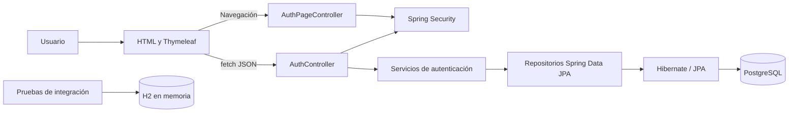

# Siweb Eclipse

Aplicación web para la gestión de un hotel. El proyecto usa Spring Boot y está organizado como un monolito por capas: interfaz web, controladores, servicios, repositorios y entidades JPA.

## Estado actual

### Implementado

- Portada de Hotel Eclipse y página 404 personalizadas.
- Login de empleados con usuario y contraseña, usando el servicio de autenticación integrado desde `feature/login`.
- Registro de clientes con datos personales, correo y contraseña; al registrarse, el cliente queda autenticado.
- Login de clientes por correo y contraseña.
- Contraseñas de clientes y empleados almacenadas con BCrypt; nunca se guarda la contraseña en texto plano.
- Sesiones HTTP para los accesos de cliente y empleado.
- Validación de datos, normalización de correos, rechazo de correo/documento duplicados y respuestas JSON de error.
- Actualización del esquema mediante Hibernate con `spring.jpa.hibernate.ddl-auto=update`.
- Pruebas unitarias, MVC y de integración con H2 en memoria. La prueba de integración registra un cliente, comprueba el hash persistido y vuelve a autenticarlo.

### Pendiente o limitado

- Recuperación de contraseña, verificación de correo y confirmación de identidad.
- Controles adicionales para producción, como límites de intentos, política de contraseñas y configuración de cookies seguras bajo HTTPS.
- Redirección tras el login a un panel según el rol y controles visibles para cerrar sesión. El login actual muestra confirmación y mantiene la sesión, pero aún no dirige a un dashboard.
- Conectar los módulos de reservas, recepción, room service, operaciones y reportes. Hay plantillas y clases preparadas, pero actualmente no se encontraron rutas MVC registradas para esos flujos.
- Validar la actualización del esquema sobre una copia de la base PostgreSQL usada por el equipo. Las pruebas automáticas usan H2 y no modifican esa base.
- Cambiar o eliminar las credenciales de empleados de prueba antes de desplegar.

## Tecnologías

- Java 21+
- Spring Boot 4
- Spring MVC y Thymeleaf
- Spring Security
- Spring Data JPA / Hibernate
- PostgreSQL para el perfil normal y despliegue
- H2 en memoria para el perfil `demo` y para pruebas
- HTML, CSS y JavaScript sin framework para las vistas de autenticación
- Maven Wrapper

## Arquitectura



### Responsabilidades por capa

- `controller`: recibe peticiones REST y solicitudes de páginas Thymeleaf.
- `service`: valida y ejecuta reglas de negocio, como registro, normalización de correo y autenticación BCrypt.
- `dao`: repositorios Spring Data JPA para consultar y persistir entidades.
- `entity`: modelo relacional persistido, incluyendo `Cliente` y `Empleado`.
- `dto`: contratos de entrada/salida de la API; evita exponer directamente las entidades.
- `config`: seguridad, codificador BCrypt, inicialización de empleados de desarrollo y configuración de Spring.
- `resources/static`: portada, estilos y JavaScript que consume la API.
- `resources/templates`: páginas Thymeleaf de login, registro, error y vistas de los módulos.

## Rutas implementadas

| Método | Ruta | Uso |
| --- | --- | --- |
| `GET` | `/` | Portada pública. |
| `GET` | `/login?tipo=empleado` | Formulario de login de empleado. |
| `GET` | `/login?tipo=cliente` | Formulario de login de cliente. |
| `GET` | `/registro` | Formulario de registro de cliente. |
| `POST` | `/api/auth/login` | Login de empleado; recibe `username` y `password`. |
| `GET` | `/api/auth/me` | Datos del empleado autenticado. |
| `POST` | `/api/auth/client/register` | Registra y autentica un cliente. |
| `POST` | `/api/auth/client/login` | Login de cliente; recibe `correoElectronico` y `password`. |
| `GET` | `/api/auth/client/me` | Datos del cliente autenticado. |
| `POST` | `/api/auth/logout` | Cierra la sesión API actual. |

El registro de cliente recibe `tipoDocumento`, `numDocumento`, `paisEmisionDoc`, `correoElectronico`, `nombre`, `apellido`, `telefono`, `edad` y `password`. La confirmación de contraseña se comprueba en el navegador y no se envía al servidor.

Las rutas API usan sesión HTTP y responden JSON. La API tiene CSRF desactivado; la cadena web mantiene CSRF activo. Las contraseñas se codifican con BCrypt. Los clientes tienen autoridad `ROLE_CLIENTE`; los empleados reciben sus roles y permisos desde la base.

### Flujo de uso

1. Arranca la aplicación con el perfil `demo` o con PostgreSQL.
2. Abre `http://localhost:8080`; no abras el HTML estático directamente desde el explorador de archivos.
3. Para un cliente nuevo, elige **Crear una cuenta** o abre `/registro`.
4. Al completar el registro, el servidor guarda la cuenta y devuelve una sesión autenticada. El formulario valida que ambas contraseñas coincidan.
5. Para una cuenta de cliente existente, abre `/login?tipo=cliente` y usa el correo y la contraseña elegidos al registrarse.
6. Para empleados, abre `/login?tipo=empleado` y usa username y contraseña de desarrollo o las credenciales de la base configurada.

### Contratos JSON

Registro de cliente, `POST /api/auth/client/register`:

```json
{
  "tipoDocumento": "DNI",
  "numDocumento": "12345678",
  "paisEmisionDoc": "PER",
  "correoElectronico": "cliente@example.com",
  "nombre": "Ana",
  "apellido": "Rojas",
  "telefono": "+51 999123456",
  "edad": 28,
  "password": "UnaClaveSegura123"
}
```

Login de cliente, `POST /api/auth/client/login`:

```json
{
  "correoElectronico": "cliente@example.com",
  "password": "UnaClaveSegura123"
}
```

Login de empleado, `POST /api/auth/login`:

```json
{
  "username": "admin",
  "password": "Admin@123"
}
```

Los logins y el registro devuelven datos básicos del usuario y guardan la autenticación en la sesión HTTP. En JavaScript las solicitudes usan `credentials: same-origin`, por lo que el navegador conserva la cookie de sesión. No se devuelve el hash de contraseña.

La lista de países del formulario envía un código ISO de tres letras (`PER`, `CHL`, `USA`, etc.). El prefijo telefónico se combina con el número antes de enviarlo, por ejemplo `+51 999123456`, y se guarda en el campo `telefono` existente.

## Requisitos

- JDK 21 o superior.
- Git.

PostgreSQL y la base `siweb_eclipse` solo son necesarios para el perfil normal. Para probar el login sin PostgreSQL basta con JDK y Maven Wrapper; usa el perfil `demo` descrito abajo.

No hace falta instalar Maven globalmente: el repositorio incluye `mvnw` y `mvnw.cmd`.

## Configuración y ejecución

### Demostración sin PostgreSQL

En Windows, desde la raíz del proyecto:

```powershell
$env:SPRING_PROFILES_ACTIVE = "demo"
.\mvnw.cmd spring-boot:run
```

En Linux/macOS:

```bash
SPRING_PROFILES_ACTIVE=demo ./mvnw spring-boot:run
```

Abre [http://localhost:8080](http://localhost:8080). Puedes crear clientes desde `/registro` y entrar como empleado con una cuenta de desarrollo. La base H2 de demostración vive solo mientras la aplicación está abierta: al detenerla, sus registros se eliminan. Esto permite probar el flujo sin PostgreSQL; no uses este perfil para producción.

### Ejecución con PostgreSQL

Configura la contraseña de PostgreSQL mediante la variable `DB_PASSWORD`. En PowerShell, el siguiente comando la solicita sin mostrarla ni enviarla al chat:

```powershell
$secure = Read-Host "Contraseña de PostgreSQL" -AsSecureString
$env:DB_PASSWORD = [System.Net.NetworkCredential]::new("", $secure).Password
```

Después, desde la raíz del proyecto:

```powershell
.\mvnw.cmd spring-boot:run
```

En Linux/macOS:

```bash
export DB_PASSWORD="contraseña-local"
./mvnw spring-boot:run
```

Abre [http://localhost:8080](http://localhost:8080). No abras `src/main/resources/static/index.html` directamente como archivo: sus rutas `/login` y `/registro` requieren que Spring Boot esté sirviendo la aplicación.

La configuración normal usa `jdbc:postgresql://localhost:5432/siweb_eclipse` y el usuario `postgres`. La contraseña se lee de `DB_PASSWORD`; el archivo actual mantiene `123456` como valor de respaldo para desarrollo. Configura una variable de entorno y evita usar el valor de respaldo fuera de una máquina local.

Si la base todavía no existe, créala una vez desde `psql` o pgAdmin:

```sql
CREATE DATABASE siweb_eclipse;
```

Al iniciar, `spring.jpa.hibernate.ddl-auto=update` crea/actualiza las tablas a partir de las entidades. No borra las tablas en el perfil PostgreSQL. Haz una copia de seguridad antes de ejecutar cambios de esquema sobre datos importantes.

### Cuentas de empleado de desarrollo

`DataInitializer` crea estas cuentas si no existen:

| Usuario | Contraseña | Rol |
| --- | --- | --- |
| `admin` | `Admin@123` | `ADMIN` |
| `recepcion1` | `Recep@123` | `RECEPCION` |
| `roomservice1` | `Room@123` | `ROOMSERVICE` |

Son credenciales de desarrollo; cámbialas antes de cualquier despliegue. Las cuentas de cliente se crean desde `/registro`.

Los clientes que ya existían antes de añadir contraseña pueden tener `password_hash` vacío. Esas cuentas no pueden iniciar sesión hasta que exista un flujo administrativo para definirles una contraseña; no se les asigna una contraseña predeterminada.

## Seguridad y límites

- Los logins y registro crean sesiones HTTP; el navegador conserva la cookie de sesión.
- Las contraseñas se guardan con BCrypt. Nunca guardes contraseñas en texto plano ni subas secretos a Git.
- El cliente debe usar el endpoint `/api/auth/client/me` y el empleado `/api/auth/me` para consultar su sesión.
- El endpoint de logout API es `POST /api/auth/logout`. La cadena web también reconoce `POST /logout`.
- El perfil `demo` es solo local: H2 usa memoria y se pierde al apagar la JVM.
- No hay recuperación de contraseña, verificación de correo, bloqueo por intentos ni límites de solicitudes.
- El login confirma la autenticación en la misma página; no hay dashboards de cliente/empleado conectados todavía.
- No despliegues con las credenciales semilla. Configura HTTPS, cookies `Secure`, secretos externos y monitoreo antes de producción.

## Solución de problemas

| Síntoma | Causa habitual | Qué revisar |
| --- | --- | --- |
| `localhost:8080` rechaza la conexión | Spring Boot no está iniciado o terminó con error. | Mantén abierta la terminal de `spring-boot:run` y revisa el primer error del log. |
| La página queda en blanco o muestra “Prohibido” al abrir el HTML | Se abrió `index.html` como archivo local. | Usa `http://localhost:8080`; las rutas `/login` y `/registro` necesitan Spring. |
| `password authentication failed for user postgres` | `DB_PASSWORD` no coincide con la contraseña local de PostgreSQL. | Vuelve a configurar la variable y reinicia Spring. No pongas el secreto en el README ni en el chat. |
| `database siweb_eclipse does not exist` | Falta crear la base vacía. | Ejecuta `CREATE DATABASE siweb_eclipse;` con un usuario autorizado. |
| `Port 8080 already in use` | Otro proceso usa el puerto. | En PowerShell: `$env:SERVER_PORT = "8081"`; luego ejecuta Maven y abre `http://localhost:8081`. |
| Cliente recibe “Credenciales inválidas” | Correo/contraseña incorrectos, cuenta creada solo en otra base o H2 reiniciado. | Usa el mismo perfil/base donde se registró; en demo crea la cuenta de nuevo tras reiniciar. |
| “Ya existe una cuenta con ese correo/documento” | Email o documento ya registrados. | Usa los datos de la cuenta existente o un email/documento distinto. |
| Login de empleado no acepta el email | Empleados se autentican con username, no correo. | Usa `admin`, `recepcion1` o `roomservice1` en modo demo. |

Para cambiar de demo a PostgreSQL, detén el proceso demo e inicia la aplicación sin `SPRING_PROFILES_ACTIVE=demo`, con `DB_PASSWORD` configurada. Los datos de H2 no se transfieren a PostgreSQL automáticamente.

## Pruebas

Ejecutar toda la suite:

```powershell
.\mvnw.cmd test
```

En Linux/macOS:

```bash
./mvnw test
```

Las pruebas de contexto e integración configuran H2 en memoria. No requieren `DB_PASSWORD` ni escriben en PostgreSQL. La última ejecución completa registrada pasó 48 pruebas.

## Estructura del proyecto

```text
src/
  main/
    java/pe/com/eclipsesuites/
      config/
      controller/
      dao/
      dto/
      entity/
      service/
      util/
    resources/
      static/css/
      static/js/
      templates/
  test/java/pe/com/eclipsesuites/
```

## Git

Crear una rama:

```bash
git checkout -b nombre-de-la-rama
```

Guardar y subir cambios:

```bash
git add .
git commit -m "Describe el cambio"
git push --set-upstream origin nombre-de-la-rama
```

## Licencia

Proyecto académico / interno del equipo. Ajustar según corresponda.
