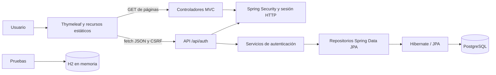

# Siweb Eclipse

Aplicación web para la gestión de un hotel. El proyecto usa Spring Boot y está organizado como un monolito por capas: interfaz web, controladores, servicios, repositorios y entidades JPA.

## Estado actual

### Implementado

- Portada de Hotel Eclipse y página 404 personalizadas.
- Login de empleados con usuario y contraseña, con roles y permisos cargados desde la base de datos.
- Registro de clientes en dos pasos: datos personales y credenciales; al terminar se inicia la sesión sin depender de códigos por correo o SMS.
- Aceptación de privacidad registrada con fecha al crear la cuenta.
- Login de clientes por correo y contraseña.
- Contraseñas de clientes y empleados almacenadas con BCrypt; nunca se guarda la contraseña en texto plano.
- Sesiones HTTP para los accesos de cliente y empleado.
- Bloqueo temporal de 3 minutos a partir del quinto fallo para la combinación de IP y usuario/correo.
- Validación de datos, normalización de correos, rechazo de correo/documento duplicados y respuestas JSON de error.
- Interfaz de autenticación adaptable a móvil, con fondo del hotel, wizard de registro, transiciones y animaciones breves; respeta `prefers-reduced-motion`.
- Actualización del esquema mediante Hibernate con `spring.jpa.hibernate.ddl-auto=update`.
- Pruebas unitarias, MVC y de integración con H2 en memoria para registro, autenticación, validaciones y sesión.

### Pendiente o limitado

- Recuperación de contraseña y controles independientes contra abuso distribuido (los límites actuales viven en memoria).
- Paneles distintos por rol y controles visibles para cerrar sesión. El login redirige a `/inicio`, pero esa página no diferencia todavía las capacidades por rol.
- Activar los módulos de reservas, checkout, rack, room service, operaciones y reportes. Hay plantillas y archivos con nombres de controlador/servicio, pero no tienen implementación activa ni rutas MVC registradas en el estado actual.
- Validar la actualización del esquema sobre una copia de la base PostgreSQL usada por el equipo. Las pruebas automáticas usan H2 y no modifican esa base.
- Cambiar o eliminar las credenciales de empleados de prueba antes de desplegar.

## Tecnologías

- Java 21+
- Spring Boot 4
- Spring MVC y Thymeleaf
- Spring Security
- Spring Data JPA / Hibernate
- PostgreSQL para el perfil normal y despliegue
- H2 en memoria para el perfil `demo` y para pruebas
- HTML, CSS y JavaScript sin framework para las vistas de autenticación
- Maven Wrapper

## Arquitectura

La aplicación es un monolito Spring Boot/MVC. La descripción de módulos, rutas, seguridad, persistencia y estado de implementación está en [ARCHITECTURE.md](./ARCHITECTURE.md).



### Responsabilidades por capa

- `controller`: recibe solicitudes REST y de páginas; las rutas activas son portada/inicio y autenticación.
- `service`: valida y ejecuta reglas de registro, política de correo, autenticación y bloqueo de intentos.
- `dao`: repositorios Spring Data JPA para consultar y persistir entidades.
- `entity`: modelo relacional persistido, incluyendo `Cliente` y `Empleado`.
- `dto`: contratos de entrada/salida de la API; evita exponer directamente las entidades.
- `config`: seguridad, codificador BCrypt, inicialización de empleados de desarrollo y configuración de Spring.
- `resources/static`: portada, imagen de fondo, estilos y JavaScript que consume la API; las animaciones y transiciones están en `home.css`.
- `resources/templates`: páginas Thymeleaf de login, registro, error y vistas de los módulos.

La cadena API mantiene CSRF activo también para los endpoints públicos de login y registro; el JavaScript solicita el token antes de enviar operaciones POST.

## Rutas implementadas

| Método | Ruta | Uso |
| --- | --- | --- |
| `GET` | `/` | Portada pública. |
| `GET` | `/login?tipo=empleado` | Formulario de login de empleado. |
| `GET` | `/login?tipo=cliente` | Formulario de login de cliente. |
| `GET` | `/registro` | Formulario de registro de cliente. |
| `GET` | `/inicio` | Página de entrada con sesión; redirige al login si no hay sesión autenticada. |
| `GET` | `/api/auth/csrf` | Emite el token CSRF que se usa en las solicitudes POST de la API. |
| `GET` | `/api/auth/client/disponibilidad?campo=...&valor=...` | Verifica disponibilidad de correo, documento o teléfono; limitado por IP. |
| `POST` | `/api/auth/login` | Login de empleado; recibe `username` y `password`. |
| `GET` | `/api/auth/me` | Datos del empleado autenticado. |
| `POST` | `/api/auth/client/register` | Crea la cuenta de cliente e inicia su sesión. |
| `POST` | `/api/auth/client/login` | Login de cliente; recibe `correoElectronico` y `password`. |
| `GET` | `/api/auth/client/me` | Datos del cliente autenticado. |
| `POST` | `/api/auth/logout` | Cierra la sesión API actual (filtro de logout de Spring Security). |
| `POST` | `/logout` | Cierra sesión mediante la cadena web de Spring Security. |

El registro de cliente recibe `tipoDocumento`, `numDocumento`, `paisEmisionDoc`, `correoElectronico`, `nombre`, `apellido`, `telefono`, `edad` y `password`. El formulario pide repetir el correo y la contraseña; compara ambos valores en el navegador y no envía los campos de confirmación al servidor.

Las rutas API usan sesión HTTP y responden JSON. CSRF también está activo para la API; la interfaz obtiene el token con `GET /api/auth/csrf` y lo envía como `X-XSRF-TOKEN`. Las contraseñas se almacenan con BCrypt. Los clientes tienen autoridad `ROLE_CLIENTE`; los empleados reciben sus roles y permisos desde la base.

### Flujo de uso

1. Arranca la aplicación con el perfil `demo` o con PostgreSQL.
2. Abre `http://localhost:8080`; no abras el HTML estático directamente desde el explorador de archivos.
3. Para un cliente nuevo, elige **Crear una cuenta** o abre `/registro`.
4. Completa los dos pasos del registro. La cuenta se crea y la sesión se inicia al enviar el formulario.
5. Para una cuenta de cliente existente, abre `/login?tipo=cliente` y usa el correo y la contraseña elegidos al registrarse.
6. Para empleados, abre `/login?tipo=empleado` y usa username y contraseña de desarrollo o las credenciales de la base configurada.

### Contratos JSON

Registro de cliente, `POST /api/auth/client/register`:

```json
{
  "tipoDocumento": "DNI",
  "numDocumento": "12345678",
  "paisEmisionDoc": "PER",
  "correoElectronico": "cliente@example.com",
  "nombre": "Ana",
  "apellido": "Rojas",
  "telefono": "+51 999123456",
  "edad": 28,
  "password": "UnaClaveSegura123"
}
```

Login de cliente, `POST /api/auth/client/login`:

```json
{
  "correoElectronico": "cliente@example.com",
  "password": "UnaClaveSegura123"
}
```

Login de empleado, `POST /api/auth/login`:

```json
{
  "username": "<usuario configurado>",
  "password": "<contraseña ingresada por el usuario>"
}
```

Los logins y el registro devuelven datos básicos del usuario y guardan la autenticación en la sesión HTTP. En JavaScript las solicitudes usan `credentials: same-origin`, por lo que el navegador conserva la cookie de sesión. No se devuelve el hash de contraseña.

La lista de países del formulario envía un código ISO de tres letras (`PER`, `CHL`, `USA`, etc.). El prefijo telefónico se combina con el número antes de enviarlo, por ejemplo `+51 999123456`, y se guarda en el campo `telefono` existente.

El formulario requiere la aceptación expresa del tratamiento de datos; el servidor guarda esa aceptación y su marca de tiempo. La política explica el uso de los datos para administrar la cuenta y gestionar servicios de hospedaje. El registro no comprueba la titularidad del correo ni del teléfono; los códigos de verificación no forman parte del flujo.

## Requisitos

- JDK 21 o superior.
- Git.

PostgreSQL y la base `siweb_eclipse` solo son necesarios para el perfil normal. Para probar el login sin PostgreSQL basta con JDK y Maven Wrapper; usa el perfil `demo` descrito abajo.

No hace falta instalar Maven globalmente: el repositorio incluye `mvnw` y `mvnw.cmd`.

### Estado de Java y compilación

El proyecto todavía tiene Java 21 como versión objetivo en `pom.xml`; no se ha aplicado la actualización del runtime a Java 25. La compilación se verificó correctamente con Java 24 usando Maven Wrapper:

```powershell
.\mvnw.cmd compile
```

En Windows no uses `mvn compile` salvo que hayas instalado Maven globalmente. Usa `.\mvnw.cmd` desde la raíz del proyecto.

## Configuración y ejecución

### Demostración sin PostgreSQL

En Windows, desde la raíz del proyecto:

```powershell
$env:SPRING_PROFILES_ACTIVE = "demo"
.\mvnw.cmd spring-boot:run
```

En Linux/macOS:

```bash
SPRING_PROFILES_ACTIVE=demo ./mvnw spring-boot:run
```

Abre [http://localhost:8080](http://localhost:8080). Puedes crear clientes desde `/registro` y entrar como empleado con una cuenta de desarrollo. La base H2 de demostración vive solo mientras la aplicación está abierta: al detenerla, sus registros se eliminan. No uses este perfil para producción.

### Ejecución con PostgreSQL

Usa esta opción si PostgreSQL está iniciado y ya existe la base `siweb_eclipse`. La aplicación se conecta a `localhost:5432` como el usuario `postgres`. No se activa el perfil `demo`.

En PowerShell, desde la raíz del proyecto, solicita la contraseña nueva de PostgreSQL de forma oculta y guárdala en la variable de entorno solo para esta ventana:

```powershell
Remove-Item Env:SPRING_PROFILES_ACTIVE -ErrorAction SilentlyContinue
$secure = Read-Host "Contraseña de PostgreSQL" -AsSecureString
$env:DB_PASSWORD = [System.Net.NetworkCredential]::new("", $secure).Password
.\mvnw.cmd spring-boot:run
```

Deja esa ventana abierta mientras uses la aplicación y abre [http://localhost:8080](http://localhost:8080). Para detenerla, presiona `Ctrl+C` en la terminal.

Si ya configuraste `DB_PASSWORD` en esa misma ventana, no necesitas volver a introducirla; ejecuta solamente `.\mvnw.cmd spring-boot:run`. Si habías iniciado la aplicación con el perfil `demo`, detenla y abre una terminal nueva antes de seguir estos pasos.

En Linux/macOS:

```bash
read -s -p "Contraseña de PostgreSQL: " DB_PASSWORD
echo
export DB_PASSWORD
./mvnw spring-boot:run
```

Abre [http://localhost:8080](http://localhost:8080). No abras `src/main/resources/static/index.html` directamente como archivo: sus rutas `/login` y `/registro` requieren que Spring Boot esté sirviendo la aplicación.

La configuración normal usa `jdbc:postgresql://localhost:5432/siweb_eclipse` y el usuario `postgres`. La contraseña se lee de `DB_PASSWORD`; no escribas la contraseña real en este README, en el código ni en el chat.

Si la base todavía no existe, créala una vez desde `psql` o pgAdmin:

```sql
CREATE DATABASE siweb_eclipse;
```

Al iniciar, `spring.jpa.hibernate.ddl-auto=update` crea/actualiza las tablas a partir de las entidades. No borra las tablas en el perfil PostgreSQL. Haz una copia de seguridad antes de ejecutar cambios de esquema sobre datos importantes.

### Validaciones del registro

- El correo se normaliza a minúsculas, debe pertenecer a un dominio permitido y ese dominio debe publicar registros MX. Por defecto se aceptan `gmail.com`, `hotmail.com`, `outlook.com` y `yahoo.com`; configura otros mediante `APP_AUTH_EMAIL_DOMINIOS_PERMITIDOS` (lista separada por comas).
- Se rechazan algunos dominios temporales conocidos. La lista se puede ajustar con `APP_AUTH_EMAIL_DOMINIOS_DESECHABLES`.
- El DNI debe tener 8 dígitos; CE y pasaporte aceptan de 6 a 20 caracteres alfanuméricos.
- El teléfono se guarda en formato E.164, por ejemplo `+51999123456`, y debe ser único. El formulario valida de forma estricta según el país elegido en el selector de prefijo (Perú: 9 dígitos que empiezan con 9; los demás países usan las longitudes oficiales) y el backend lo confirma con libphonenumber más una regla estricta para Perú.
- El formulario comprueba correo, documento y teléfono al salir de cada campo. La consulta usa `GET /api/auth/client/disponibilidad`, no almacena en caché sus respuestas y limita a 30 consultas por minuto y dirección IP en cada instancia. Como GET incluye el valor consultado en la URL, no habilites registros de acceso que almacenen sus query strings en servidores o proxies.
- Para nuevas contraseñas de clientes se requieren entre 8 y 20 caracteres; la lista local de claves prohibidas en `src/main/resources/security/claves-prohibidas.txt` bloquea claves conocidas y también se rechazan contraseñas que contengan datos personales. El formulario muestra un indicador compacto de fortaleza, sin checklist de recomendaciones. BCrypt mantiene el límite técnico de 72 bytes UTF-8.
- La lista de claves prohibidas incluida es una lista local compacta, no contiene 1.000 entradas. Para producción, incorpora y mantén una lista institucional revisada antes de afirmar que se bloquean las 1.000 contraseñas más usadas.
- Antes de reiniciar PostgreSQL después de añadir la restricción de teléfono, comprueba si hay valores duplicados existentes:

```sql
SELECT telefono, COUNT(*)
FROM cliente
GROUP BY telefono
HAVING COUNT(*) > 1;
```

Si aparecen filas, no las borres automáticamente: conserva los datos y resuelve los duplicados antes de aplicar la restricción única.

### Cuentas de empleado de desarrollo

`DataInitializer` crea estas cuentas si no existen:

| Usuario | Contraseña | Rol |
| --- | --- | --- |
| `admin` | Configurada por `APP_SEED_ADMIN_PASSWORD` | `ADMIN` |
| `recepcion1` | Configurada por `APP_SEED_RECEPCION_PASSWORD` | `RECEPCION` |
| `roomservice1` | Configurada por `APP_SEED_ROOMSERVICE_PASSWORD` | `ROOMSERVICE` |

El inicializador solo se ejecuta con los perfiles `demo` y `dev`. Las contraseñas semilla no tienen valores predeterminados en el código. Si falta cualquiera de las tres variables al iniciar uno de esos perfiles, se crean los roles, pero se omite la creación de las cuentas nuevas. Las cuentas que ya existen no se modifican.

En PowerShell, configura cada clave de desarrollo con una entrada oculta antes de iniciar con perfil `demo` o `dev`:

```powershell
foreach ($variable in @("APP_SEED_ADMIN_PASSWORD", "APP_SEED_RECEPCION_PASSWORD", "APP_SEED_ROOMSERVICE_PASSWORD")) {
    $secure = Read-Host "Contraseña para $variable" -AsSecureString
    [Environment]::SetEnvironmentVariable($variable, [System.Net.NetworkCredential]::new("", $secure).Password, "Process")
}
```

La API requiere CSRF también para login, registro y cierre de sesión. La interfaz obtiene el token de `GET /api/auth/csrf` y lo envía en el encabezado `X-XSRF-TOKEN`. Las sesiones expiran tras 30 minutos de inactividad; la cookie es `HttpOnly` y `SameSite=Lax`. La cookie solo lleva `Secure` cuando se activa el perfil `prod`, por lo que ese perfil debe servirse por HTTPS.

Tras cinco fallos para la misma combinación de IP e identidad, los siguientes intentos quedan bloqueados 3 minutos. El mensaje indica el tiempo restante; los contadores son locales a cada instancia y se borran al reiniciarla, por lo que un despliegue con varias instancias debe mover este control a almacenamiento compartido antes de depender de él como barrera distribuida.

Son credenciales de desarrollo; cámbialas antes de cualquier despliegue. Las cuentas de cliente se crean desde `/registro`.

Los clientes que ya existían antes de añadir contraseña pueden tener `password_hash` vacío. Esas cuentas no pueden iniciar sesión hasta que exista un flujo administrativo para definirles una contraseña; no se les asigna una contraseña predeterminada.

## Seguridad y límites

- Los logins y registro crean sesiones HTTP; el navegador conserva la cookie de sesión.
- Las contraseñas se guardan con BCrypt. Nunca guardes contraseñas en texto plano ni subas secretos a Git.
- El cliente debe usar el endpoint `/api/auth/client/me` y el empleado `/api/auth/me` para consultar su sesión.
- El endpoint de logout API es `POST /api/auth/logout`. La cadena web también reconoce `POST /logout`.
- El perfil `demo` es solo local: H2 usa memoria y se pierde al apagar la JVM.
- No hay recuperación de contraseña; los límites de login y reenvío se mantienen en memoria/locales a cada instancia.
- El login confirma la autenticación en la misma página; no hay dashboards de cliente/empleado conectados todavía.
- No despliegues con las credenciales semilla. Configura HTTPS, cookies `Secure`, secretos externos y monitoreo antes de producción.

## Solución de problemas

| Síntoma | Causa habitual | Qué revisar |
| --- | --- | --- |
| `localhost:8080` rechaza la conexión | Spring Boot no está iniciado o terminó con error. | Mantén abierta la terminal de `spring-boot:run` y revisa el primer error del log. |
| La página queda en blanco o muestra “Prohibido” al abrir el HTML | Se abrió `index.html` como archivo local. | Usa `http://localhost:8080`; las rutas `/login` y `/registro` necesitan Spring. |
| `password authentication failed for user postgres` | `DB_PASSWORD` no coincide con la contraseña local de PostgreSQL. | Vuelve a configurar la variable y reinicia Spring. No pongas el secreto en el README ni en el chat. |
| `database siweb_eclipse does not exist` | Falta crear la base vacía. | Ejecuta `CREATE DATABASE siweb_eclipse;` con un usuario autorizado. |
| `Port 8080 already in use` | Otro proceso usa el puerto. | En PowerShell: `$env:SERVER_PORT = "8081"`; luego ejecuta Maven y abre `http://localhost:8081`. |
| Cliente recibe “Credenciales inválidas” | Correo/contraseña incorrectos, cuenta creada solo en otra base o H2 reiniciado. | Usa el mismo perfil/base donde se registró; en demo crea la cuenta de nuevo tras reiniciar. |
| “Ya existe una cuenta con ese correo/documento” | Email o documento ya registrados. | Usa los datos de la cuenta existente o un email/documento distinto. |
| Login de empleado no acepta el email | Empleados se autentican con username, no correo. | Usa `admin`, `recepcion1` o `roomservice1` en modo demo. |

Para cambiar de demo a PostgreSQL, detén el proceso demo e inicia la aplicación sin `SPRING_PROFILES_ACTIVE=demo`, con `DB_PASSWORD` configurada. Los datos de H2 no se transfieren a PostgreSQL automáticamente.

## Pruebas

Ejecutar toda la suite:

```powershell
.\mvnw.cmd test
```

En Linux/macOS:

```bash
./mvnw test
```

Las pruebas de contexto e integración configuran H2 en memoria. No requieren `DB_PASSWORD` ni escriben en PostgreSQL. La última ejecución completa pasó 74 pruebas.

## Estructura del proyecto

```text
src/
  main/
    java/pe/com/eclipsesuites/
      config/
      controller/
      dao/
      dto/
      entity/
      service/
      util/
    resources/
      static/css/
      static/js/
      templates/
  test/java/pe/com/eclipsesuites/
```

## Git

Crear una rama:

```bash
git checkout -b nombre-de-la-rama
```

Guardar y subir cambios:

```bash
git add .
git commit -m "Describe el cambio"
git push --set-upstream origin nombre-de-la-rama
```

## Licencia

Proyecto académico / interno del equipo. Ajustar según corresponda.
